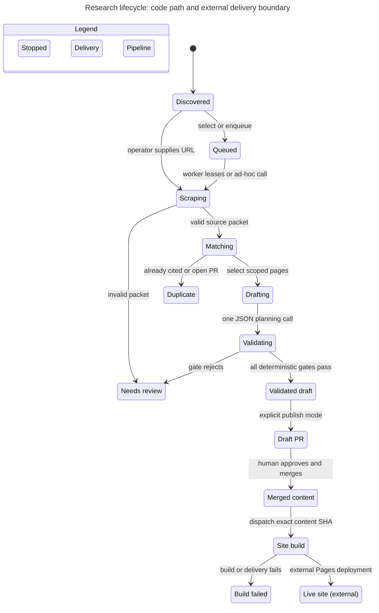
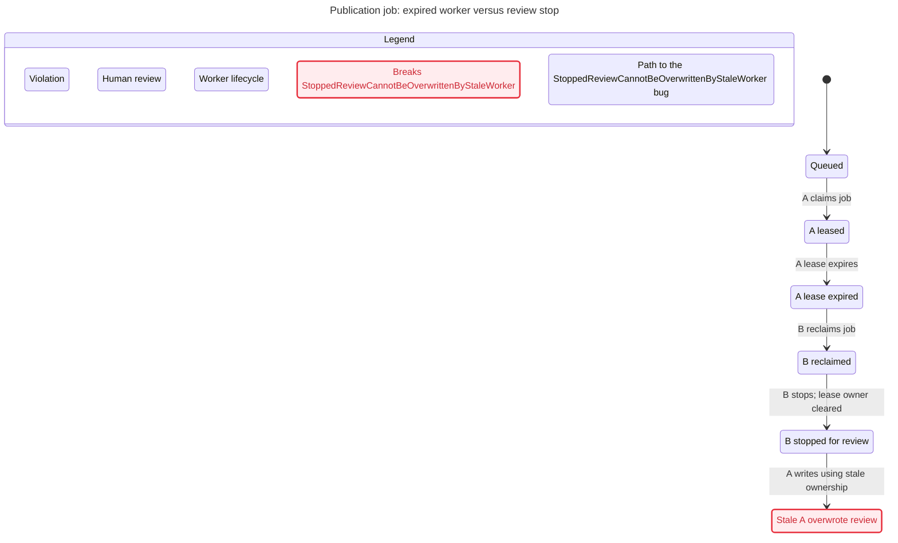
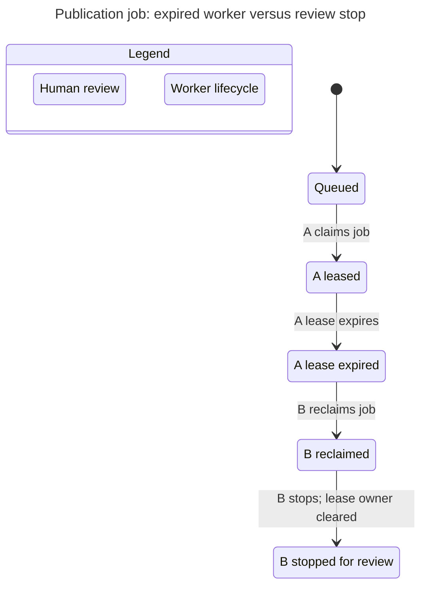

## Scope and reading guide

**Reviewed 2026-11-04.** This atlas maps the current local code and installed runtime, using `diagram-generator` for structure and `statechart-generator`/TLC/Pele for bounded behavior. There are **14 architecture views and 3 statechart variants**. Diagrams are authored explanations backed by the listed sources, not automatic discovery of the entire live estate. Source repositories, DOI-fix worktree and current service configuration were inspected; Cloudflare account settings, hosted-model integrations and restored mail contents were not audited.

 explains priorities and uncertainty. Orange dashed proposal arrows indicate recommendations, not current services. The three lifecycles—paper record, publishing execution and delivered site—are deliberately separate.

## Architecture views

Each view includes SVG for zooming, PNG for straightforward viewing and YAML as editable source. Open a component to inspect it; the diagrams are split by responsibility so one giant chart is not required.

### Research repository ownership

Repository roles and the separation of project knowledge from public research content.

 ·  · 

<details open><summary>View diagram</summary>



</details>

Sources: `Research/workspace-repos.tsv`; `Research/AGENTS.md`; `content/.github/workflows/trigger-sites.yml`; `wikip.co/.github/workflows/generator.yml`.

### Research from discovery to delivery

One-attempt default path. Scheduled intake/publishing remain disabled on this host.

 ·  · 

<details open><summary>View diagram</summary>



</details>

Sources: `research-tools/agent-workflow`; `wiki_automation/cli.py: local_worker_command`; `wiki_automation/local_publish.py: run_local_publish`.

### Scholar intake and human selection

Current data contracts; the active UI does not imply Gmail authentication or scheduled sync.

 ·  · 

<details><summary>View diagram</summary>



</details>

Sources: `gmail_reader/app.py: sync_messages, parse_articles_from_html, enqueue_publication_backlog`; `gmail_reader/web.py: Handler`.

### Source acquisition and identity gate

The local DOI repair prevents cited-reference identity from being assigned to the article; it is committed and pushed on `fix/iconium-local-runtime`, pending review.

 ·  · 

<details><summary>View diagram</summary>



</details>

Sources: `web-scraper/main.py: extract_article_data, enrich_metadata, extraction_issues`; `local scraper patch in restoration evidence`.

### Simple publisher: model proposal, code authority

Default simple path is distinct from the retained multi-pass legacy critic path.

 ·  · 

<details><summary>View diagram</summary>



</details>

Sources: `local_publish.py: simple_draft_prompt, validate_simple_draft_plan, run_local_publish`; `local_publish.py: validate_rendered_markdown`.

### Queue ownership and retry boundaries

Both highlighted current queue failure cases were replayed on synthetic temporary databases, never the production DB.

 ·  · 

<details><summary>View diagram</summary>



</details>

Sources: `gmail_reader/app.py: claim_publication_job, set_publication_job_state, requeue_publication_job`; `wiki_automation/cli.py: local_worker_command`.

### Research records: three different lifecycles

processed_at, pr_open and merged/live are not interchangeable; no automatic end-to-end live receipt was found in this local queue path.

 ·  · 

<details><summary>View diagram</summary>



</details>

Sources: `gmail_reader/app.py: ensure_db, set_publication_job_state`; `gmail_reader/web.py: ensure_job_tables, run_job`; `local_publish.py: finish`.

### Local inference runtime and prompt boundary

Measured real request: 10,031 input / 1,147 output tokens, 175.274 seconds, approximately 7.6 generated tokens/s; no HIP benchmark.

 ·  · 

<details><summary>View diagram</summary>



</details>

Sources: `local_publish.py: LocalLLMClient`; `installed research-llm.service`; `restoration dry-run report`.

### Human review to public site: distinct delivery stages

Repository workflows establish the dispatch/build chain; a current Cloudflare account deployment was not audited.

 ·  · 

<details><summary>View diagram</summary>



</details>

Sources: `content/.github/workflows/trigger-sites.yml`; `wikip.co/.github/workflows/generator.yml`; `wikip.co/scripts/prepare-content`.

### Iconium current operational topology

Running components are separated from missing credentials and disabled automation; no LAN exposure is configured for the wiki.

 ·  · 

<details><summary>View diagram</summary>



</details>

Sources: `installed user units and local Compose`; `read-only mount and restore checks`; `GWS auth presence checks`.

### Authority boundaries: proposal versus side effects

The legacy triage UI Codex launcher has broader authority than the read-only agent backend; do not conflate those paths.

 ·  · 

<details><summary>View diagram</summary>



</details>

Sources: `local_publish.py: FrontierAgentClient, run_local_publish`; `gmail_reader/web.py: codex_command`; `auth-bootstrap and scripts/fetch-vault-secrets.sh`.

### research-tools package responsibilities

Five Python packages plus external Node and browser runtimes; a successful doctor result is not full dependency/auth health.

 ·  · 

<details><summary>View diagram</summary>



</details>

Sources: `research-tools/pyproject.toml`; `research-tools/agent-workflow`; `package pyproject.toml files`.

### Proposed learning loop: make review outcomes actionable

This is a recommendation, not an implemented or enabled autonomous loop.

 ·  · 

<details><summary>View diagram</summary>



</details>

Sources: `retained needs_review report`; `review findings from this session`.

### Project knowledge and agent handoff

New local knowledge home is separate from public research articles and the central cross-project wiki.

 ·  · 

<details><summary>View diagram</summary>



</details>

Sources: `Research/AGENTS.md local change`; `wiki/AGENTS.md`; `user knowledge-ownership decision`.

## Model-checked behavior

TLC checks the explicit small models below, not the Python implementation. Every model stays well below the 500-state budget. No invariant was removed or weakened to force a pass. Reports list the exact shortest counterexample path where a rule breaks. Only terminal stuttering (`Done`) is hidden by the views; all substantive transitions remain visible.

| Variant | Reachable states / steps | Chart states / arrows | Result |
| --- | --- | --- | --- |
| One-attempt lifecycle | 14 / 20 | 14 / 15 | PR gate and human-approval invariants plus NoDeadlock hold in the abstraction |
| Current lease behavior | 6 / 7 | 6 / 5 | Stale-worker invariant breaks; path replayed against real queue functions |
| Proposed fenced lease behavior | 5 / 5 | 5 / 4 | Same invariant holds in the proposal model; implementation remains unchanged |

### Lifecycle assumptions

The flow abstracts one source and one processing attempt; queue retries and legacy multi-pass critics are covered by separate views, not expanded into this graph. Gate outcomes are nondeterministic booleans; a pass in this model does not establish scientific correctness. Human merge is an external action. Successful site delivery is an assumed external transition, not a measured Cloudflare deployment. Validated dry-run, duplicate, review and failed-build states can stop without deadlock.

### Lease model assumptions and confirmed replay

There is one job and two workers; time is reduced to an expiry event. The real queue uses an atomic SQLite claim and rejects a worker while a different non-empty owner is present. But stopping for review clears ownership, after which the current state-update function accepts the old worker again. The invariant is: **a worker whose lease was superseded must not overwrite the review-stopped result**.

The shortest path from the current report is **0 Queued → 1 A claims → 2 A expires → 3 B reclaims → 4 B stops for review and clears owner → 5 stale A overwrites the result**. This is **confirmed at the queue function boundary** using a disposable SQLite database. A complete two-process production publisher/network interleaving was not replayed. The proposed model blocks step 5 with fencing; it does not implement a Python/SQL fix or prove all concurrency safety properties.

The exhausted-final-attempt crash is separately confirmed by replay: a job with `max_attempts=1` is claimed, its lease is expired synthetically, and a second claim returns false while state remains `leased`. It is not encoded as another checked liveness theorem here.

### One-attempt research lifecycle



 ·  ·  · 

<details><summary>Mermaid text</summary>



</details>

### Current lease overwrite path



 ·  ·  · 

<details><summary>Mermaid text</summary>



</details>

### Proposed fenced lease boundary



 ·  ·  · 

<details><summary>Mermaid text</summary>



</details>

## Sources, replays and regeneration

- 
- , , 
- , , , 
-  and 
- 

The `.txt` suffix preserves code/model downloads as static files. `wiki/scripts/render-research-atlas` materializes the model filenames in a temporary directory and runs the tools with the expected exit verdicts. From Research:

```bash
./wiki/scripts/render-research-atlas
```

It expects sibling `~/Projects/diagram-generator` and `~/Projects/statechart-generator`; override the paths with `DIAGRAM_GENERATOR_ROOT` and `STATECHART_GENERATOR_ROOT`. The full commands embedded in the script invoke the actual generators, not hand-edited SVGs. Container access uses ordinary Docker first, then already-authorized `sudo -n docker` if needed. The source YAML and TLA+/view/config files are authoritative; rendered files are review artifacts.

## Tool assessment

The statechart wrapper bootstrapped checksum-verified TLC 1.7.4 and Temurin JRE 25.0.5+8, and installed Pele 1.9.0. All four supplied SCIM policies produced the expected verdicts and SVGs. This review's three charts also rendered SVG/PNG with the required Pele path; the expected failing lease variant is a successful diagnostic, not a broken installation. The full vendored upstream test suite was not claimed as run.

The architecture tool's container built, all **234 tests** passed, compilation/help checks passed, and a wrapper-driven JSON smoke test produced a 3-node/2-edge diagram. The fourteen authored specs validated as **135 nodes and 136 relationships across views**, then produced 28 SVG/PNG artifacts. The same conceptual component can appear in several views; those totals are not counts of distinct deployed resources. Unknown icons are not invented; the atlas intentionally uses descriptive boxes. The smoke fixture's one reported generic icon fallback was not hidden.

Both tools are ready for this review without a broad rewrite. Suggested improvements are optional: explicit minimum-Node checks in the statechart bootstrap, clearer user-versus-root Docker instructions, and checksum/version verification for an already-existing local JRE. These are review suggestions, not defects demonstrated in the generated charts or changes applied to the tool repositories.
